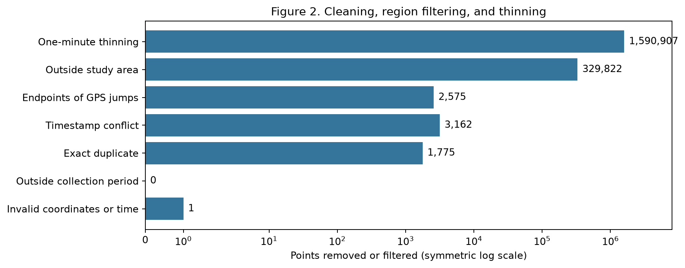
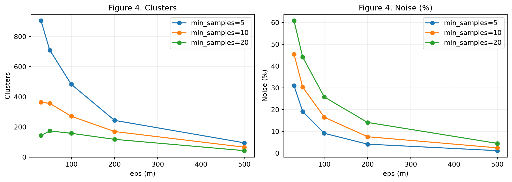
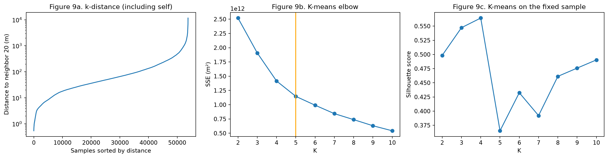
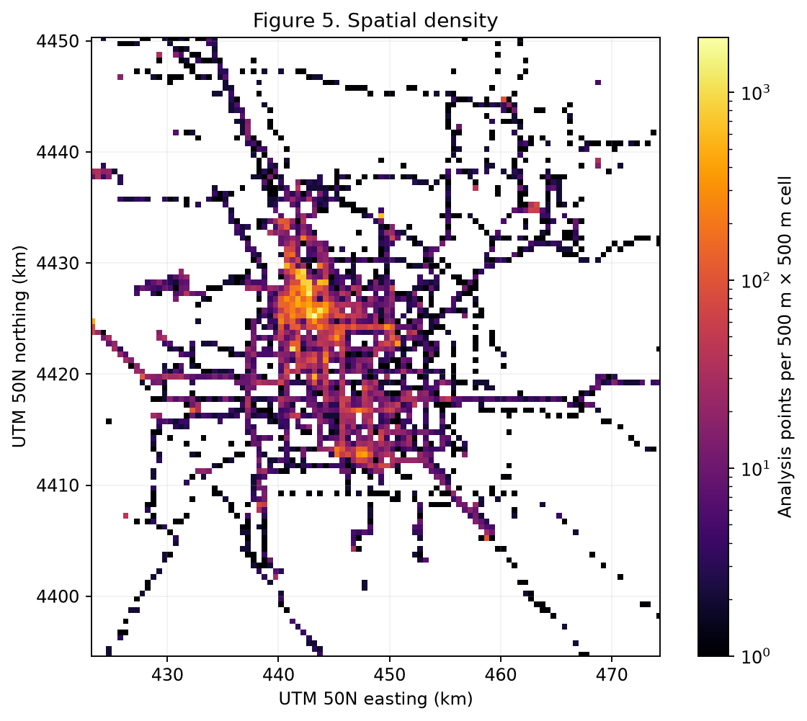
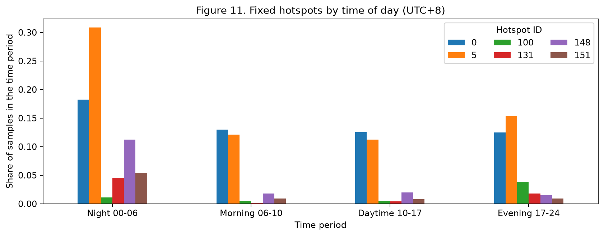

# Project A Travel Hotspot Discovery

The study uses Geolife 1.3 within longitude 116.1–116.7° and latitude 39.7–40.2° in Beijing. The full inventory contains 182 users, 18,670 trajectory files, and 24,876,978 points. Deterministic selection retained 30 users and up to 40 trajectories per user. After cleaning, the workflow keeps the first point per minute and caps the analysis points per user. The final sample has 53,786 analysis points across 1,102 trajectories. The selection is not population-representative, and Geolife includes multiple modes of travel.

## Method and Workflow

The workflow streams the ZIP, checks timestamps, coordinates, duplicates, and jumps, filters by region, thins by minute, and projects to metric coordinates in UTM 50N (EPSG:32650). It compares a DBSCAN grid with K-means and uses UTC+8 for time features. Hotspots describe observed activity density. Congestion requires separate evidence.

The DBSCAN grid tests eps of 30, 50, 100, 200, and 500 m with `min_samples` of 5, 10, and 20, for 15 combinations. The main 50 m and 20-point configuration produces 174 hotspots and 30,040 non-noise points, with 55.851% coverage and 44.149% noise. The silhouette score is 0.108585 on a fixed sample of 2,000 non-noise points.

K-means compares K = 2–10 and selects K = 5 by the geometric elbow relative to the endpoints of the normalized SSE curve. On a 2,000-point sample from the full support, K = 5 has a silhouette score of 0.365287. On the same 30,040 non-noise DBSCAN support, DBSCAN and K-means score 0.108585 and 0.427705 respectively. Interpret these internal comparisons on shared support.

## Hotspots, Time, and Candidates

The 500 m grid heatmap shows aggregate spatial density. Total variation between the spatial shares before and after thinning is 0.143323, indicating that thinning changes the observed distribution.

Within the fixed DBSCAN footprint, compare normalized hotspot shares at night, in the morning, during the day, and in the evening.

The threshold of at least 20 analysis points and at least 80% noise identifies 115 low-density candidates. External anomaly ground truth is unavailable. A single 90% subsample perturbation gives an ARI of 0.906379 including the noise label. ARI measures clustering agreement.

## Submission Scope and Reproduction

The instructor copy includes code, configuration, unit tests, aggregate tables, anonymized counts, and the five plots above. The package excludes point-level coordinates, user and trajectory IDs, individual space-time endpoints, and single-trajectory plots. Hotspot and K-means tables retain cluster sizes and bounding-box dimensions while excluding exact centers and bounds. Figures 07 and 08 and precise point-cloud scatterplots are outside the public package.

The default `python run.py` checks aggregate arithmetic and figures without the original ZIP. For a full rerun, obtain a legitimate copy of the source ZIP and run `python run.py full --data <ZIP> --out <new-directory>`. The root submission manifest covers the actual public files. The older source checksum list records the historical package.
