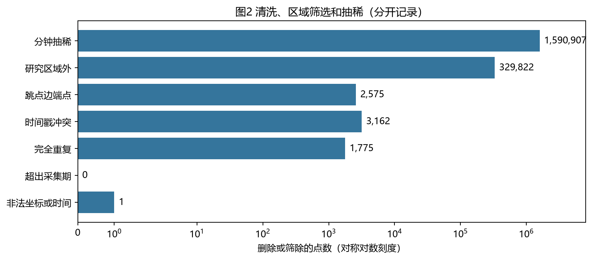
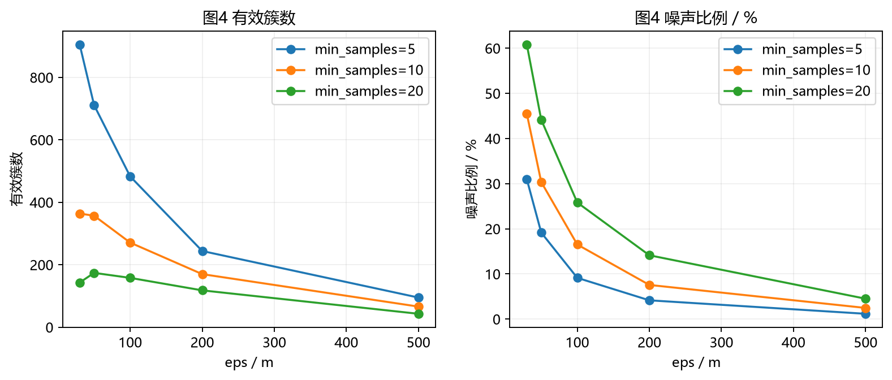
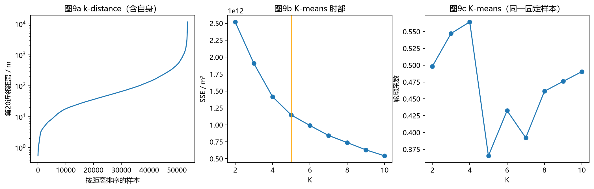
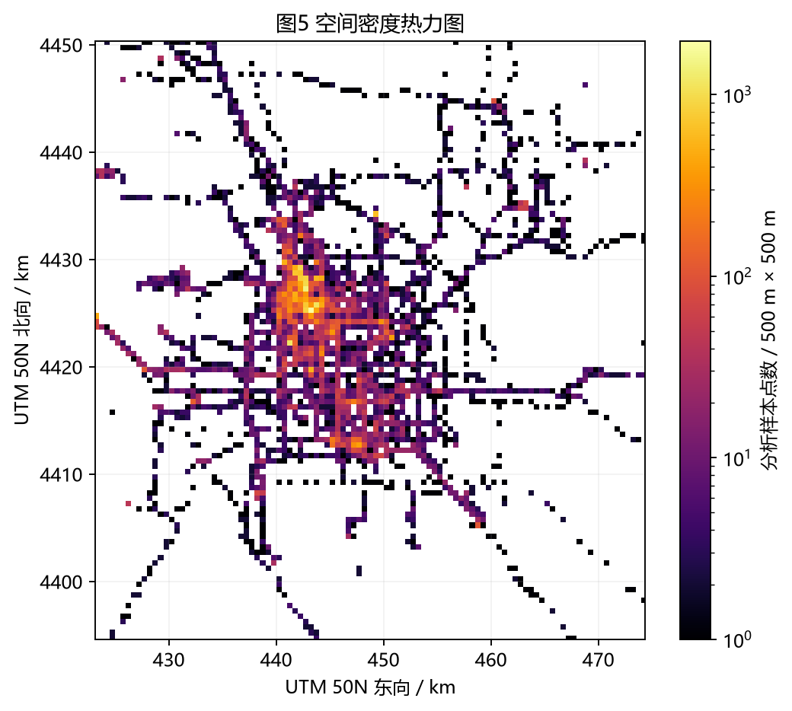
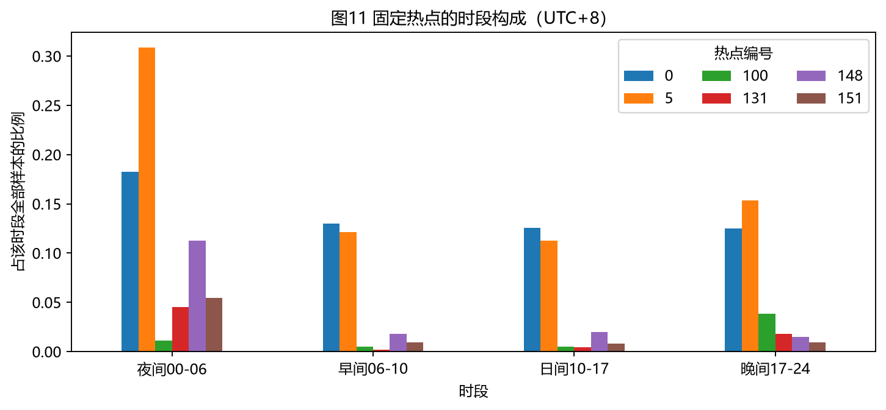

# Project A：出行热点区域发现（教师提交版）

本实验使用Geolife 1.3，研究北京经度116.1–116.7、纬度39.7–40.2范围。全量数据盘点182名用户、18,670份轨迹、24,876,978个点；按确定性规则选30名用户、每用户最多40条轨迹，清洗后以一分钟分桶抽稀并限制每用户分析点数。最终模型使用53,786个分析点、1,102条轨迹。选样不是人口代表性抽样，Geolife用户不能全部称为车辆。

## 方法与流程

ZIP流式读取、时间/坐标/重复与跳点检查，区域筛选，分钟抽稀，UTM 50N（EPSG:32650）米制坐标，DBSCAN网格搜索与KMeans对照。时间特征使用UTC+8。高密度热点对应观察到的出行活动密度，不能直接解释为拥堵。

DBSCAN遍历eps=30/50/100/200/500m与min_samples=5/10/20，共15组。主参数50m/20得到174个热点簇，30,040个非噪声点，覆盖55.851%、噪声44.149%。非噪声固定2,000点抽样轮廓系数0.108585。

KMeans比较K=2–10，按归一化SSE两端连线的几何肘部规则选K=5。该K不是轮廓系数最大值。K=5全体分析支持的2,000点轮廓为0.365287；在DBSCAN非噪声的共同30,040支持上，DBSCAN/KMeans轮廓分别为0.108585/0.427705。不同支持上的数值不能直接横比，也不能称为分类准确率。

## 热点、时间与候选

500m网格热力图用于观察整体密度；原始抽稀前后空间占比分布总变差为0.143323，说明抽稀会改变空间密度，不能忽略抽样偏差。

对固定DBSCAN足迹，比较夜间、早间、日间、晚间各时段的归一化热点占比。

对至少20个分析点且噪声占比≥0.8的轨迹，得到115条低密度候选。该规则没有真实异常标签，不能宣称检出115条已证实异常驾驶。90%子样本扰动得到含噪声标签的ARI=0.906379，它衡量聚类一致性，不是准确率。

## 提交范围与复现

本教师副本保留源码、配置、单元测试、聚合表、匿名计数和上述5张图。逐点经纬度、用户ID、轨迹ID、个体起止时空和单轨迹图不入包；热点与KMeans表去掉精确中心和包围盒坐标，保留簇规模和宽高。原用户明细图07、单轨迹案例图08及精确点云散点图不随包交付，因此本文所有图链接均指向实际保留文件。

默认 `python run.py` 只复核聚合算术与图文件，不要求原始ZIP，也不谎称重新运行点级模型。完整重跑需自行合法获得Geolife原始ZIP并显式执行 `python run.py full --data <ZIP> --out <新目录>`。源目录旧checksums.sha256已陈旧，本次提交重新建立完整清单；不能把旧清单当作本次通过证据。
