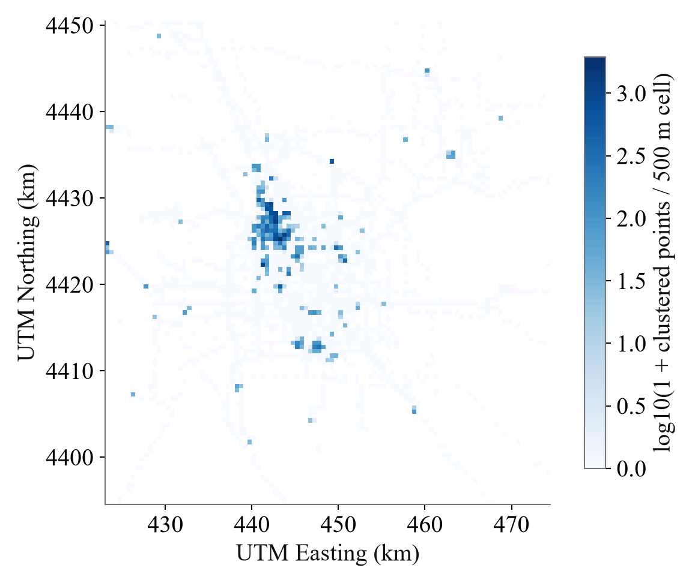
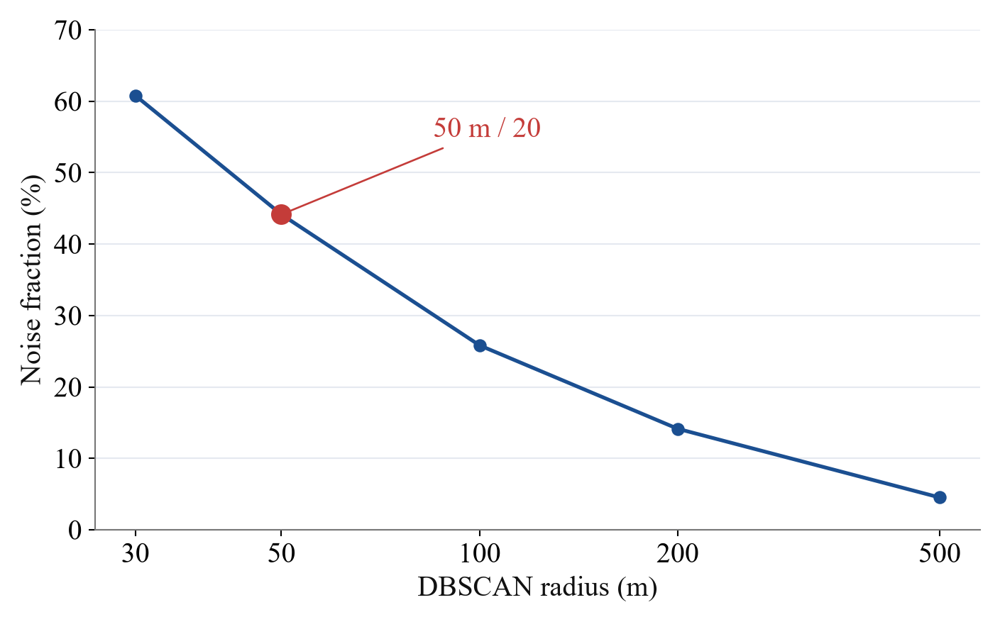
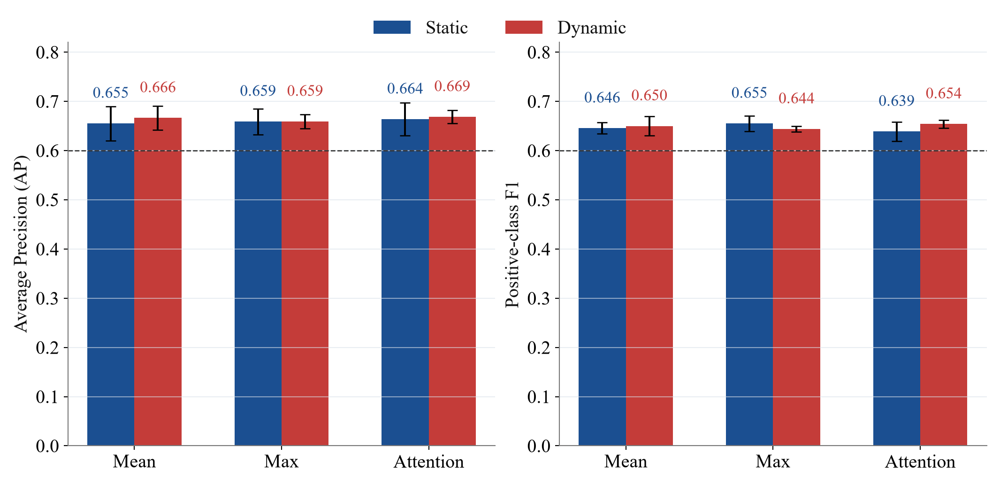
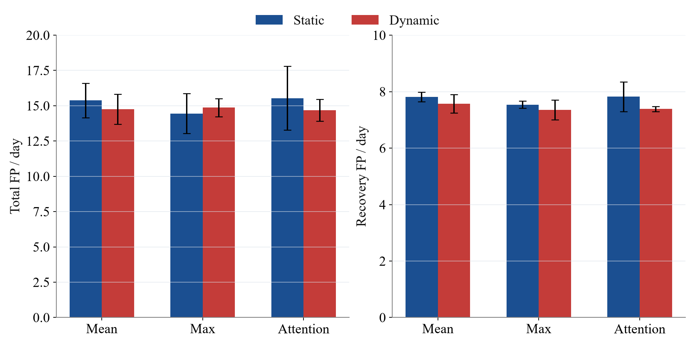

# Traffic Data Mining Final Experiment Report

Report date: November 17, 2026

- Project A: Geolife travel hotspots and low-density candidates
- Project B: Road congestion proxy early warning with a dynamic-edge Graph Transformer

## Abstract

This coursework covers two traffic data analysis workflows. Project A uses Geolife trajectories and applies quality cleaning, geographic filtering, temporal thinning, and controlled sampling. It compares DBSCAN and KMeans spatial clustering and examines hotspots, parameter sensitivity, and low-density candidates. The analysis sample contains 30 users, 1,102 trajectories, and 53,786 points. The main DBSCAN setting produced 174 clusters, covered 55.85% of points, and labeled the remaining 44.15% as noise.

Project B first tested whether the original Geolife assignment provided usable labels. All 578 road-minute windows were labeled `unknown` because historical support was insufficient, which blocked formal training. To evaluate the Graph Transformer, the rerun used a separate supplemental proxy task based on publicly available aggregated segment speeds from the New York City Department of Transportation. It retained the original peak periods, a past-only historical baseline, and an audit of unknown labels. Predictions were issued strictly ten minutes ahead. Three pooling methods and three seeds produced 18 dynamic-model fits across development and final training. The comparison also reused 18 verified static controls. Dynamic Mean, selected on development, achieved AP of 0.6664 ± 0.0243 and positive-class F1 of 0.6501 ± 0.0195 on the same 80,536 known test windows. Its daily total and recovery false positives were 14.600 and 7.504, exceeding the calibration targets of 12 and 6.

Projects A and B use separate data and evaluation protocols. Project B does not use Project A's cluster labels. The evidence does not establish that a hotspot causes congestion. The New York results come from temporal backtesting on previously public dates. The original Geolife assignment and a new independent blind test remain separate evaluations.

## 1. Course Objectives and Scope

The course material is `Lecture1-logistics-DM2026V3-part1.pdf`. Project A appears on physical pages 9–10 and requires loading and cleaning Geolife data, feature extraction, clustering, parameter sensitivity, algorithm comparison, hotspot and unusual-trajectory analysis, and visualization. Project B appears on pages 11–15. Its original requirements are to select trajectories of 100 users from 2010 through 2012, extract records from 07:00–09:00 and 17:00–19:00, define congestion as speed below 40% of the historical mean for the same period for at least five minutes, and compare neural and conventional models.

Following the agreed methodology change, Project B reports a Graph Transformer with Mean, Max, and Attention pooling. User counts, date coverage, road-network scope, and ground-truth limitations are reported according to the data available.

| Course requirement | Status | Evidence and scope |
| --- | --- | --- |
| A: cleaning, clustering, parameter sensitivity, and algorithm comparison | Complete | 15 DBSCAN settings, K = 2–10, common-support comparison, and result figures |
| A: hotspots across individuals, low-density candidates, and temporal distributions | Exploratory analysis complete | No verified unusual-driving labels. Geolife contains multiple travel modes. |
| A: combine the road network with real traffic events | Not implemented | Road-network matching and parking or congestion event validation remain unverified. |
| B: original Geolife peak-period cleaning, nearest-road matching, and label diagnosis | Partially complete | Insufficient history. All 578 windows are unknown, blocking formal training. |
| B: original Geolife supervised classification and cause validation | Incomplete | Road matching rates do not establish classification accuracy. Performance plots require known labels. |
| B: Graph Transformer with three pooling methods, dynamic edge weights, and actual training | Complete for the supplemental New York proxy experiment | The labels, road network, and years differ from the original Geolife task. |
| B: new independent blind test and causal analysis of interventions | Incomplete | Previously public dates support backtesting. False-positive budgets remain unmet. |

## 2. Project A Data and Preprocessing

### 2.1 Source and Sample Construction

The source is Geolife Trajectories 1.3. The original ZIP contains 353,488,286 bytes. Its SHA-256 is:

`16c2caed998e80828acd5fe7b15404593d1752f2a1524505633c23fdfac8a066`

The full inventory contains 182 users, 18,670 trajectory files, and 24,876,978 points. There are mode-label files for 69 users. Project A did not use mode labels for supervised classification. The trajectories include modes other than motor vehicles.

The study region is a Beijing rectangle with longitude 116.1–116.7 and latitude 39.7–40.2. The configured period is 2007-04-01 through 2012-09-01, excluding the end date. The analysis sample spans 2007-09-03 09:52:08 through 2011-12-27 05:18:00 UTC. The Project A slides do not impose Project B's 100-user or 2010–2012 constraints.

Users first had to contribute at least 1,000 raw points within the region. The pipeline selected the first 30 qualifying users in ascending identifier order. Within each user, it ordered trajectories using a hash of a fixed seed and the ZIP member name and retained up to 40 with points in the study region. This selection is a controlled sample. Its results do not establish representativeness of the full user population.

| Data stage | Count | Unit |
| --- | ---: | --- |
| Selected trajectory files | 1,108 | Files |
| Raw points in the selected files | 2,029,261 | GPS points |
| After quality cleaning | 2,021,748 | GPS points |
| Inside the study region | 1,691,926 | GPS points |
| First point retained in each one-minute bin per trajectory | 101,019 | Representative points |
| After capping each user at 2,000 points | 53,786 | Final clustering points |
| Final trajectories and users | 1,102 / 30 | Trajectories / users |

### 2.2 Cleaning, Projection, and Features

For each trajectory, the pipeline handles invalid coordinates and timestamps, exact duplicates, conflicting timestamps, and both endpoints of jumps with adjacent-point speeds over 100 m/s. Speed links do not reconnect over rejected points or gaps longer than 300 seconds. Geographic filtering precedes retention of the first point per one-minute trajectory bin and controlled per-user sampling. These steps reduce repeated contributions from users with high recording frequencies.

WGS84 coordinates are projected to EPSG:32650, with distances in meters. Clustering uses only the two projected x/y coordinates. Time, speed, and altitude support preprocessing, diagnosis, and time-of-day summaries. Spatio-temporal deep clustering remains outside the implementation.

## 3. Project A Methods and Results

### 3.1 DBSCAN and KMeans

DBSCAN uses an `eps` neighborhood and `min_samples` to find density-connected points while retaining a noise category. The grid combines eps = [30, 50, 100, 200, 500] meters with min_samples = [5, 10, 20] for 15 settings. The main setting uses eps = 50 meters and min_samples = 20.

KMeans partitions the same 53,786 points into K clusters. The experiment evaluated K = 2–10 and selected K = 5 with the geometric elbow rule. Silhouette score was not the selection criterion. The methods differ in cluster scale, treatment of noise, and objective. Their internal metrics do not measure classification accuracy for real activity areas.

| Measure | Verified result | Evaluation support |
| --- | ---: | --- |
| Main DBSCAN cluster count | 174 | Fixed sample of 53,786 points |
| DBSCAN non-noise points | 30,040 | 55.85096% coverage |
| DBSCAN noise points | 23,746 | 44.14904% noise |
| DBSCAN silhouette score | 0.108585 | Fixed draw of 2,000 non-noise points |
| KMeans K | 5 | Geometric elbow rule |
| KMeans silhouette on full support | 0.365287 | Fixed draw of 2,000 points from the full sample |
| KMeans silhouette on common support | 0.427705 | Draw of 2,000 from the same 30,040 DBSCAN non-noise points |

A common-support comparison should report the 30,040-point support and its sampling procedure. The full-support KMeans score of 0.365 and the non-noise DBSCAN score of 0.109 come from different supports and do not rank classification accuracy.

### 3.2 Sensitivity, Perturbation, and Candidate Screening

At min_samples = 20, increasing eps from 30 to 500 meters reduced the noise rate from 60.8002% to 4.51976%. The spatial scale substantially changes which hotspots merge and which points are labeled noise. The main configuration came from a grid expanded during development, as opposed to a single preregistered selection.

One perturbation retained 90% of the sample, giving 48,407 points, 155 clusters, and 46.5986% noise. Including the noise labels, the adjusted Rand index was 0.906379. ARI measures agreement between clusterings. It is not 90.6% classification accuracy, and one perturbation cannot establish robustness under all sampling conditions.

Screening for at least 20 analysis points and a noise share of at least 80% yielded 115 low-density candidates. They may reflect infrequent activity, sparse sampling, or data issues. No external abnormal-driving ground truth was available to confirm them.

### 3.3 Figures and Privacy

The presentation uses a 500-meter aggregate spatial density map, cluster sizes, a parameter-versus-noise curve, and a KMeans elbow plot. The source values are included in the package. Presentation figures avoid precise individual points, paths, identities, and links to individual times.





Independent DBSCAN and KMeans refits on the original full point table reproduced the existing labels value for value. The original nine engineering tests passed. The submitted copy defaults to aggregate-table consistency checks for counts, coverage, the elbow, common support, density bias, time shares, and privacy fields. Recomputing silhouettes or ARI requires point-level data. The two validation scopes are recorded separately.

## 4. Project B Original Task Diagnosis and Supplemental Data

### 4.1 Status of the Original Geolife Project

`Evidence/B_evidence.json` records the values read from the original course Project B `training_status.json` and `pipeline_summary.json`. Status was `blocked`, `formal_training_executed=false`, and all 578 road-minute windows were `unknown` because of `insufficient_history`. The original Geolife project had no usable two-class labels for formal supervised training. This is the historical Geolife source. The submission's ProjectB directory contains the New York dynamic-edge version.

The original ratio of 8198/8267, approximately 99.165%, measures inclusion through nearest-road matching. It does not measure congestion classification accuracy. The original requirements for user count, 2010–2012 coverage, and evidence of congestion lasting at least five minutes were not fully met. Road-network vintage and geometric nearest-road matching also introduce potential bias.

### 4.2 Supplemental New York Proxy Protocol

The supplemental data comes from NYC DOT public table `i4gi-tjb9`. It contains 54 speed shards and 1,019,891 raw records and uses 121 fixed directed segments. The dates run from 2026-05-11 through 2026-11-11. The peak periods are 07:00–09:00 and 17:00–19:00 in New York local time, and the latest source timestamp is `2026-11-11T17:12:06`. The final day is incomplete. Its fixed road windows remain in the evaluation, with unknown labels audited.

Speeds are in mph. Valid speed is greater than 0 and at most 85, with positive finite `travel_time`. The original status field alone does not remove records with valid speeds. For duplicate segment/timestamp observations, the pipeline takes the median. It aggregates the two five-minute half-bins separately and combines them into a ten-minute speed estimate. The estimate is missing if either half-bin is missing.

The historical baseline is specific to the directed segment, ten-minute time bin, and weekday or weekend type. It requires at least three qualifying past training days. Training days use only earlier dates, and the training baseline is frozen for evaluation. Positive labels require two consecutive estimated speeds, each strictly below 40% of its own historical mean. A current window with enough evidence and no low speed is negative. Missing evidence or current low speed without confirmation in both successive bins is unknown. Unknowns remain excluded from the negative class.

The two estimated ten-minute bins define a proxy label. They cannot establish that speed stayed low in each individual minute, and they differ from the original five-minute sustained-congestion ground truth. New York data also lack the combination of Geolife user trajectories, travel mode, and altitude and do not meet the original requirements for 100 users, 2010–2012, or the Beijing road network.

| Period (start inclusive, end exclusive) | Dates | Days | Known windows | Positive | Negative | Unknown |
| --- | --- | ---: | ---: | ---: | ---: | ---: |
| Final training | 05-11 to 08-31 | 112 | 171,672 | 4,649 | 167,023 | 153,576 |
| Separate calibration | 08-31 to 09-28 | 28 | 47,780 | 1,476 | 46,304 | 33,532 |
| Historical backtest | 09-28 to 11-12 | 45 | 80,536 | 2,866 | 77,670 | 50,144 |

The test grid contains 130,680 fixed windows. Known coverage is 61.6284%, and the positive rate among known windows is 3.5587%. Adjacent ten-minute positives on the same road are merged into 796 proxy episodes. Road segments overlap across the periods, so the protocol tests forward-time generalization on the same segments. The public aggregate table has no person or trajectory identifiers and cannot demonstrate cross-user isolation or generalization to new roads.

## 5. Project B Graph Transformer Method

### 5.1 Features Available Strictly Ten Minutes Ahead

Let t be the start of the target window. The system issues its warning at t−10. The latest complete dynamic input is bin t−2, covering [t−20, t−10). The speeds in t−1 and t used to determine the label, the low-speed ground truth, and later observations are excluded from model inputs. The same cutoff applies to the central and neighboring segments.

The 52 feature columns capture past speed, speed relative to and deviating from its historical baseline, trends, past support, road and time information, half-bin changes, and valid-report coverage. Imputation and standardization are fitted only on training data. The pipeline appends 52 missingness indicators, producing tensors of shape [B, N, 104]. New York data lack the original bus counts and message counts, so their placeholder columns remain missing. Probe coverage is not imputed as an observed field. Past road transition rates are updated only when a training day is complete and are frozen during evaluation.

### 5.2 Directed-Graph Attention and Dynamic Edge Priors

Directed road segments are nodes. Fixed geometric endpoint-continuity and turn-angle rules create 56 candidate directed edges. There are 54 isolated nodes. Each one-hop target subgraph has at most five valid nodes, with local index 0 assigned to the target. Neighbors and padding carry mappings and masks. Batches exchange no information.

The model projects 104 input features to width 32. It uses two backbone layers with four attention heads per layer and eight dimensions per head. Target i attends only to its physical predecessors j and to itself.

`score(i,j,h) = Q_i K_jᵀ / sqrt(8) + log w(j→i,h) + directed_mask`

After softmax weighting of V, each layer applies an output projection, a residual connection, LayerNorm, a 32→64→32 feed-forward network, and a second residual connection and LayerNorm. Valid lagged features account for temporal dependence. Attention runs across local road nodes.

Dynamic edge weighting uses eight past attributes at each endpoint and their missingness indicators to construct a 48-dimensional description. A 48→16→4 MLP produces a per-head log prior of `log(2) × tanh(MLP)` in each layer, restricting multipliers to [0.5, 2]. Self-loops and edges with missing latest relative speed at either endpoint use multiplier 1. Disallowed edges remain masked. The two layers add 1704 parameters. Zero initialization starts the multipliers at 1. At test time, frozen parameters produce multipliers that vary with admissible inputs, without updating the model online or creating network connections.

### 5.3 Three Pooling Methods and Target Alignment

Mean pooling averages each feature across valid nodes. Max pooling takes the elementwise maximum. Attention pooling learns aggregation weights for valid nodes. Each method produces a 32-dimensional subgraph vector and concatenates it with the 32-dimensional target node representation. A 64→32→1 classifier then emits a sigmoid score for that road segment. The three pooling models are trained independently, and predictions stay aligned to individual segments.

### 5.4 Training, Model Selection, and Thresholds

The seeds are 11, 22, and 33. Training uses two layers, width 32, four heads, weighted BCE, Adam with lr = 0.001, batch size 128, and 12 epochs. CPU jobs use two threads per process with at most four concurrent jobs. Each known training sample is visited exactly once per epoch. Unknown labels are excluded from supervised loss and remain in the fixed prediction grid.

Development training uses [05-11, 08-03) and development validation uses [08-03, 08-31). Dynamic Mean was selected by mean development AP across the three seeds, with F1 and registration order breaking ties. The saved final epoch for each pooling method is the median of its three best development epochs. All medians were 11, and every run still completed 12 epochs. Partitions are chronological. Shuffling within the training partition is only for optimization.

Thresholds were fitted on the 28-day calibration period by maximizing positive-class F1 under daily mean limits of 12 total false positives and six recovery false positives. The model weights and thresholds were then frozen for backtesting. Test data were used neither to retune thresholds nor to choose a seed. Sigmoid scores received no additional probability calibration. AP is calculated with `sklearn.average_precision_score`.

## 6. Project B Backtest Results

### 6.1 Paired Static and Dynamic Comparisons Across Pooling Methods

The comparisons use the same 80,536 known windows and seeds 11, 22, and 33. Reported variations are sample standard deviations around the mean. Operating points use the F1 threshold from calibration under the false-positive constraints.

| Method | AP | Positive-class F1 | Balanced accuracy | Recall | Total FP/day | Recovery FP/day |
| --- | --- | --- | ---: | ---: | ---: | ---: |
| Static Mean | 0.6553 ± 0.0348 | 0.6455 ± 0.0114 | 0.7892 | 0.5870 | 14.756 | 7.578 |
| Dynamic Mean (development selection) | 0.6664 ± 0.0243 | 0.6501 ± 0.0195 | 0.7919 | 0.5922 | 14.600 | 7.504 |
| Static Max | 0.6591 ± 0.0262 | 0.6551 ± 0.0158 | 0.7955 | 0.5994 | 14.652 | 7.630 |
| Dynamic Max | 0.6591 ± 0.0144 | 0.6440 ± 0.0053 | 0.7833 | 0.5743 | 13.341 | 6.852 |
| Static Attention | 0.6638 ± 0.0332 | 0.6388 ± 0.0196 | 0.7832 | 0.5747 | 14.289 | 7.459 |
| Dynamic Attention | 0.6687 ± 0.0134 | 0.6541 ± 0.0079 | 0.7941 | 0.5965 | 14.489 | 7.348 |



Relative to Static Mean, Dynamic Mean increased AP by 0.01118 and F1 by 0.00453. Dynamic Attention increased F1 by 0.01528 against the static control with the same pooling method. Dynamic Max decreased F1 by 0.01115. All three dynamic pooling methods averaged above 0.60 on both AP and F1. The primary model's 14.600 total false positives per day and 7.504 recovery false positives per day still exceeded budget. The higher Attention test result does not change the development selection of Mean.

Dynamic Mean has accuracy of 0.9773, with approximately 96.44% negatives among known test samples. AP, F1, balanced accuracy, and false positives are therefore the main reported metrics. An individual sigmoid score is not overall classification accuracy. Class-weighted training also means its score is not directly a calibrated event probability.

### 6.2 Recovery False Positives at Matched Recall

The table uses equal true-positive counts on the same full evaluation support, giving actual recall of 0.6001396. This is a retrospective ranking diagnostic with observed labels. It does not select a deployment threshold from the test set.

| Pooling | Static total FP/day | Dynamic total FP/day | Static recovery FP/day | Dynamic recovery FP/day |
| --- | ---: | ---: | ---: | ---: |
| Mean | 15.3778 | 14.7481 | 7.8148 | 7.5704 |
| Max | 14.4444 | 14.8667 | 7.5407 | 7.3556 |
| Attention | 15.5407 | 14.6815 | 7.8222 | 7.3852 |



For Mean, both false-positive measures decreased in 3/3 seeds. Pairing 1000 date-block resamples gave a 95% conditional interval of [-0.5852, 0.0891] for the difference in recovery FP60/day and [-0.0040, 0.0120] for the F1 difference. Both intervals include zero, leaving a stable advantage unestablished. For Attention, the recovery FP60/day interval was [-0.9333, -0.0739]. All intervals are conditional on the existing models and dates. They are unadjusted for multiple comparisons and exclude future drift.

### 6.3 Reproduction and Limitations

The existing 2026-11-12 run package passed 81 engineering and portability tests in the `niulaoshi` environment. Sampled replay across 36 models had a maximum probability difference of 0. Rebuilding the two prepared datasets from the packaged raw CSV files produced byte-identical SHA-256 hashes. A complete retraining of 18 dynamic models in a fresh path containing spaces reproduced individual weights and summaries against the reference. The 18 verified static controls were reused and counted separately from new training.

The New York results are a backtest on previously public dates. A new independent blind test remains outstanding. Candidate edges are determined by road geometry, 54 nodes are isolated, observations have coverage gaps, and independent arrival timestamps are unavailable. Importance and attention weights cannot establish traffic causality, and the experiment does not estimate effects of unverified lane expansion or staggered travel interventions.

## 7. Data Protection, Provenance, and Submission Integrity

The instructor package excludes the original Geolife ZIP and exact individual points, point-level labels, and links between individual trajectories and times. It includes Project A source, configuration, aggregate tables, 500-meter figures, and verification evidence. Reviewers reproducing the point-level pipeline must obtain the original ZIP legally and specify a fresh output directory. Any locally generated point-level intermediates remain subject to the data use conditions.

Project B includes the official NYC aggregate segment speed snapshot, source query, download time and hashes, road geometry, prepared data, trained models, and segment-window predictions for individual samples. The package contains no private Geolife trajectories, credentials, or Conda binaries. See `ProjectB/data_sources_and_usage.md` for data provenance and use conditions. The underlying data were not rewritten to meet target metrics.

Project A's old `checksums.sha256` contains 56 entries, of which 53 refer to files still present. Three referenced files are missing, and 14 current SHA-256 values differ. This submission safely refitted and verified labels and statistics using the current CSV files, then built a new `manifest.csv` and `SHA256SUMS` for the delivered files. The old verification failures and source hashes remain on record in `Evidence` and `ProjectA/evidence`.

The new manifest lists package-relative paths, sizes, purposes, and SHA-256 hashes. `SHA256SUMS` may include the manifest's hash and omits its own. The ZIP hash is stored alongside the ZIP. See the acceptance record in the delivery root for the final extraction checks and execution scope. The original course directory, old projects, and old audit packages were retained read-only.

## 8. Instructor Verification and Reproduction

After extracting the archive, open Anaconda Prompt in the `FinalCourse_ProjectAB` root and use the existing environment.

```bat
conda activate niulaoshi
python ProjectA/run.py
python ProjectB/run.py
```

Project A's default entry point checks aggregate consistency without the original ZIP. Project B's default entry point independently recalculates metrics from existing predictions. The bundled public data and weights support model replay. Both projects write new directories under their own `runs` paths and preserve the submitted results.

```bat
python ProjectA/run.py tests
python ProjectB/run.py tests
python ProjectB/run.py replay
python ProjectB/run.py predict
```

For a full rebuild, use these commands.

```bat
python ProjectA/run.py full --data "D:\data\Geolife Trajectories 1.3.zip" --out "D:\CourseRuns\A_new"
python ProjectB/run.py prepare
python ProjectB/run.py train --output "D:\CourseRuns\B_new"
```

For Project A, `--data` must point to a legally obtained original ZIP, and `--out` must be a new directory. Project B's `train` runs 18 complete dynamic fits and reuses 18 static controls. Its `prepare` step rebuilds from the bundled, fixed public snapshot and preserves the unknown-sample and missingness-mask rules.

## 9. Conclusion

Project A identified hotspots and compared clustering methods internally on a fixed sample. It describes spatial activity density and sensitivity to parameters. Low-density candidates still require external verification. Project B implemented directed-graph-constrained attention, dynamic edge priors, three pooling methods, and a strict time cutoff. It achieved reproducible training and common-support evaluation on the New York proxy task. The primary model averaged above 0.60 on AP and F1, while the false-positive budgets and new independent validation remain open.

Together, the projects document the workflow from data evidence, cleaning, and features to modeling, comparison, figures, reproduction, and integrity auditing. Interpret each result within its data and evaluation scope. Internal clustering metrics, road matching rates, and historical backtests measure different outcomes and leave the original unmet course requirements open.

## References and Evidence

- Course requirements: `Evidence/course_requirements.md`, physical pages 9–10 for A and 11–15 for B.
- Current A verification: `Evidence/A_evidence.md`, `A_evidence.json`, and test records.
- A aggregate submission and provenance transformations: `ProjectA/README_instructor.md`, `ProjectA/evidence/`, and `ProjectA/results/`.
- B metrics across three seeds and paired intervals: `ProjectB/reference/results/summary.json`, `ProjectB/reference/results/operating_points.csv`, `ProjectB/reference/results/matched_recall.csv`, and `ProjectB/reference/results/paired_date_blocks.csv`.
- B label support and model freezing: `ProjectB/reference/evidence/cohort_final.json` and `ProjectB/reference/evidence/dynamic_threshold_freeze.json`.
- B reruns and environment: `ProjectB/local_run_verification.json`, `ProjectB/validation_logs/`, and `ProjectB/requirements-lock.txt`.
- Presentation figures and values: PNG, SVG, and CSV files under `Figures/`. The 10-slide deck, PDF, and slide-by-slide script are in `01_presentation/`.

## Package Acceptance on November 17, 2026

The candidate ZIP was extracted to a fresh directory and verified in the existing `niulaoshi` environment. Root hash validation, the two default project verification commands, all nine Project A tests, all 81 Project B tests, and replay of 36 models passed. See `../Evidence/fresh_directory_acceptance/` for the original commands, exit codes, timing, environment, and console output. After including the logs, only evidence and descriptions were added or revised, during this historical package acceptance. Code, data, models, figures, and the PowerPoint stayed byte-identical. The final ZIP underwent a separate full manifest and hash verification, with its overall SHA-256 stored in `delivery_files_SHA256.txt` next to the delivered ZIP.
