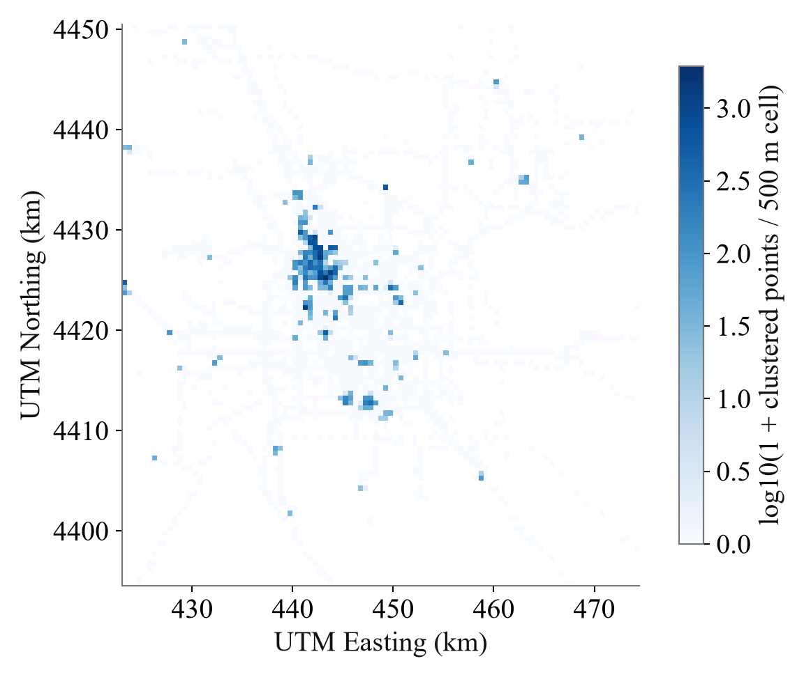
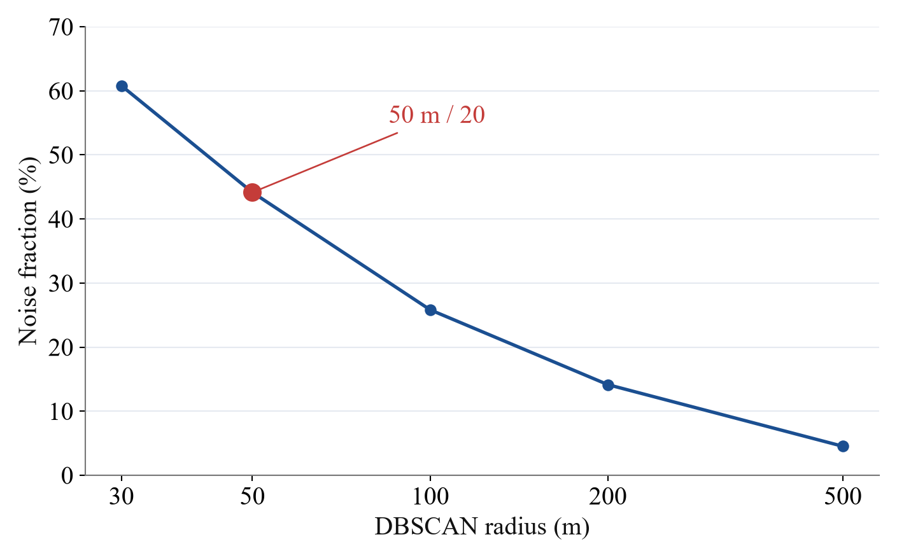
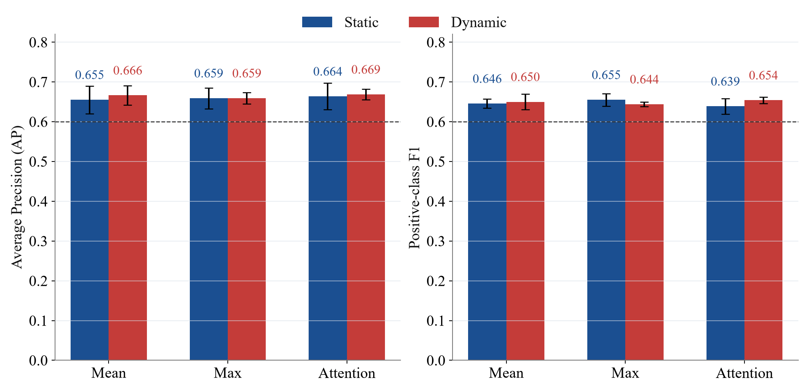
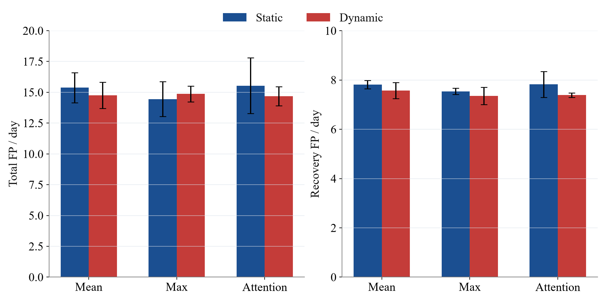

# 交通数据挖掘期末实验总报告

报告日期：2026年11月17日

项目A：Geolife出行热点与低密度候选分析  
项目B：动态边权Graph Transformer道路拥堵代理预警

## 摘要

本作业分别完成两条交通数据分析流程。Project A使用Geolife轨迹，通过质量清洗、区域筛选、时间稀疏化和受控抽样，比较DBSCAN与KMeans的空间聚类，分析热点、参数敏感性和低密度候选。正式分析样本为30名用户、1,102条轨迹、53,786点；主DBSCAN形成174簇，覆盖55.85%，保留44.15%为噪声。

Project B首先核查课程原Geolife任务的标签可行性。原目录578个道路分钟窗全部因历史支持不足而标记unknown，正式训练受阻。为实际验证Graph Transformer，采用纽约市交通局公开路段聚合估速数据开展独立补充代理任务，保留原高峰、过去历史基准与未知标签审计，并实施严格提前十分钟预警。重跑包括三种池化、三个种子、开发与最终训练共18次动态模型fit，另复用18个已核验静态对照。开发预选动态Mean在相同80,536个已知测试窗口上的AP为0.6664±0.0243，正类F1为0.6501±0.0195，日均误报14.600、恢复误报7.504，仍超过校准目标12和6。

A与B采用独立的数据和评价协议。A的聚类标签没有输入B，不能据此认定某热点导致拥堵。纽约结果为已公开历史日期的时间回测，不能替代课程原Geolife数据或新的独立盲测。

## 一、课程目标与本次工作范围

课程原课件为`Lecture1-logistics-DM2026V3-part1.pdf`。Project A任务见物理第9—10页，要求Geolife加载、清洗、特征提取、聚类、参数敏感性、算法比较、热点与异常轨迹分析及可视化。Project B见第11—15页，原要求选100名用户2010—2012年的轨迹，提取07:00—09:00与17:00—19:00记录，以低于同期历史均速40%且持续至少5分钟定义拥堵，并比较神经网络与传统模型。

本次按已明确的方法更改要求，以Graph Transformer和Mean、Max、Attention三种池化汇报B。用户数、年份、路网及真值证据的限制仍按实际数据报告。

| 课程内容 | 当前完成情况 | 证据与边界 |
| --- | --- | --- |
| A：数据清洗、聚类、参数敏感性、算法比较 | 完成 | 15组DBSCAN、K=2—10、同支持比较和真实结果图 |
| A：不同主体热点、低密度候选、时间分布 | 完成探索性分析 | 没有真实异常驾驶标签，Geolife含多种出行方式 |
| A：道路网络与真实交通事件结合 | 未实施 | 不宣称已完成路网匹配、停车或拥堵事件验证 |
| B：原Geolife高峰清洗、近邻道路匹配、标签诊断 | 部分完成 | 历史支持不足，578窗unknown，正式训练blocked |
| B：原Geolife监督分类和成因验证 | 未完成 | 不能以匹配率代替分类准确率，不能输出空标签上的性能图 |
| B：Graph Transformer三池化、动态边权和真实训练 | 完成纽约补充代理实验 | 标签、路网和年份与原Geolife任务有明确差异 |
| B：全新独立盲测、干预因果推断 | 尚未完成 | 当前公开日期仅作回测，误报预算也未满足 |


## 二、Project A：数据与预处理

### 2.1 来源和样本形成

原数据为Geolife Trajectories 1.3。当前原ZIP大小353,488,286字节，实际SHA-256为：

`16c2caed998e80828acd5fe7b15404593d1752f2a1524505633c23fdfac8a066`

全量盘点包含182名用户、18,670个轨迹文件、24,876,978点，其中69名用户具有方式标签文件。A没有将方式标签用于监督分类，不能把全部轨迹称为机动车。

研究区域为北京矩形，经度116.1—116.7、纬度39.7—40.2；配置的有效时期为2007-04-01至2012-09-01，右端不含。正式分析样本实际UTC范围为2007-09-03 09:52:08至2011-12-27 05:18:00。A课件没有B的“100名用户、2010—2012年”约束。

用户先满足区域原始点至少1,000个的条件，再按编号升序取30人。每人按固定种子与ZIP成员名哈希排序，最多取40条区域内有点的轨迹。采样不是全体用户的随机代表样本，因此结论限于当前受控样本。

| 数据阶段 | 数量 | 统计单位 |
| --- | ---: | --- |
| 选中轨迹文件 | 1,108 | 文件 |
| 选中文件原始点 | 2,029,261 | GPS点 |
| 质量清洗后 | 2,021,748 | GPS点 |
| 研究区域内 | 1,691,926 | GPS点 |
| 每轨迹一分钟分桶保留首点 | 101,019 | 代表点 |
| 每用户最多2,000点后 | 53,786 | 最终聚类点 |
| 最终轨迹/用户 | 1,102 / 30 | 轨迹/用户 |

### 2.2 清洗、投影与特征

逐轨迹处理非法坐标和时间、完全重复、冲突时间戳及相邻速度超过100m/s的跳点两端。速度边不跨被拒绝点或超过300秒的缺口重连。随后区域筛选、每轨迹一分钟保留首点，再作每用户受控抽样，减少高频记录主体的重复贡献。

WGS84经纬度投影到EPSG:32650，距离单位为米。聚类只使用投影后的二维x/y坐标；时间、速度、海拔用于预处理、诊断和分时汇总。当前没有做时空联合深度聚类。

## 三、Project A：方法与实测结果

### 3.1 DBSCAN与KMeans

DBSCAN通过eps邻域与min_samples识别密度相连的点，可保留噪声。实验网格为eps=[30,50,100,200,500]米、min_samples=[5,10,20]，共15组。主方案eps=50米、min_samples=20。

KMeans将同一53,786点划分为K个簇，测试K=2—10，并按几何肘部规则选择K=5。K不是按最高轮廓系数选择。两方法的簇尺度、噪声处理和目标不同，不能把内部评价直接解释为发现真实活动区的分类正确率。

| 项目 | 复核结果 | 支持说明 |
| --- | ---: | --- |
| 主DBSCAN簇数 | 174 | 固定53,786点 |
| DBSCAN非噪声点 | 30,040 | 覆盖55.85096% |
| DBSCAN噪声点 | 23,746 | 噪声44.14904% |
| DBSCAN轮廓系数 | 0.108585 | 非噪声支持中固定抽2,000点 |
| KMeans K | 5 | 几何肘部规则 |
| KMeans全样本轮廓 | 0.365287 | 全样本支持中固定抽2,000点 |
| KMeans共同支持轮廓 | 0.427705 | 同一DBSCAN非噪声30,040点支持中抽2,000点 |

公平的共同支持比较应说明30,040点支持及抽样口径。不能将KMeans全样本0.365与DBSCAN非噪声0.109直接当作相同样本下的准确率排名。

### 3.2 敏感性、扰动与候选筛查

固定min_samples=20时，eps从30增至500米，噪声率从60.8002%降至4.51976%，表明空间尺度会显著改变热点合并和噪声归属。主方案存在开发阶段的参数扩充过程，不宣称事先登记后一次盲选。

保留90%样本的单次扰动使用48,407点，得到155簇、噪声46.5986%，包含噪声标签的ARI为0.906379。ARI衡量两次聚类的一致性，不是90.6%的分类准确率，单次扰动也不能概括所有采样条件下的稳定性。

以分析点数至少20且噪声占比至少80%筛得115个低密度候选。候选可能对应稀少活动、采样不足或数据问题，没有外部异常真值，不能称为115次已确认异常驾驶。

### 3.3 图形和隐私处理

本次汇报使用500米聚合空间热图、簇规模、参数噪声曲线和KMeans肘部图，图源数值随包提供。展示图避免个人精确点、轨迹路径、身份和时间联结。





当前原点表上的DBSCAN与KMeans全样本独立重拟合标签与既有结果逐值一致，原9项工程测试通过。教师提交副本默认只做聚合表一致性核验，其检查覆盖总量、覆盖率、肘部、共同支持、密度偏差、时间占比及隐私字段；它不会在没有点级数据时重新计算轮廓或ARI。两种复核范围分别记录。

## 四、Project B：原任务诊断与补充数据

### 4.1 原Geolife工程的实际状态

`Evidence/B_evidence.json`保存了原课程ProjectB的training_status.json和pipeline_summary.json当前读取值：状态为blocked，formal_training_executed=false，578个道路分钟窗全部为unknown，原因为insufficient_history；没有可用于正式监督训练的双类标签。此处指原Geolife工程的历史来源，提交包ProjectB目录采用纽约动态边权版本。

原工程8198/8267约99.165%的数字是近邻道路匹配纳入率，不是拥堵分类准确率。原课件要求的用户数、2010—2012覆盖和持续至少5分钟拥堵证据未得到完整满足，原路网的年代和几何近邻匹配也存在偏差。

### 4.2 纽约公开补充代理协议

补充数据来自NYC DOT官方公开表i4gi-tjb9，54个速度分片、1,019,891条原始记录，固定121条有向路段。纽约本地时间，07:00—09:00及17:00—19:00，日期为2026-05-11至2026-11-11，最新源时刻2026-11-11T17:12:06。最后一天不完整，仍保留固定道路窗口并审计unknown。

速度单位mph，合格速度>0且≤85、travel_time为正且有限。原status字段不单独剔除仍有有效速度的记录；同一路段同时间戳取中位数，再对两个五分钟半格分别聚合，合成十分钟估速。缺任一半格则该估速缺失。

历史基准按同有向路段、十分钟时段、工作日/周末类型，使用至少三个过去合格训练日；训练日只用过去，评估期冻结训练基准。正类要求相邻两格估速分别严格低于各自历史均速40%；当前有充分证据且不低速为负类；缺证据或当前低速未能连续确认为unknown。unknown不补成负类。

该双十分钟估速规则属于代理标签，不能证明每一分钟的持续低速，也不等同原课件五分钟持续拥堵真值。纽约没有Geolife的用户轨迹、方式与海拔组合，也不满足其100用户/2010—2012/北京路网口径。

| 阶段（左闭右开） | 日期 | 天数 | 已知窗 | 正例 | 负例 | unknown |
| --- | --- | ---: | ---: | ---: | ---: | ---: |
| 最终训练 | 05-11至08-31 | 112 | 171,672 | 4,649 | 167,023 | 153,576 |
| 独立校准 | 08-31至09-28 | 28 | 47,780 | 1,476 | 46,304 | 33,532 |
| 历史回测 | 09-28至11-12 | 45 | 80,536 | 2,866 | 77,670 | 50,144 |

测试固定窗口130,680个，known覆盖61.6284%，已知阳性率3.5587%，同道路连续十分钟正例合并为796个代理事件段。道路在各段重叠，协议是同路段向后时间泛化；公开聚合表没有人员/轨迹ID，不能声称完成了跨用户隔离或跨路段泛化。

## 五、Project B：Graph Transformer完整方法

### 5.1 严格提前十分钟的特征

目标窗口起点记为t，在t−10发出预警。最新完整动态输入为t−2格[t−20,t−10)，标签涉及的t−1与t两格速度、低速真值和未来观测不进入模型。中心和邻接路段同样截断。

52列特征包含过去速度、相对历史速度与偏差、趋势、过去支持、道路/时间信息、半格变化和合法报告覆盖。填补及标准化仅在训练段拟合，再拼52个缺失位，输入为[B,N,104]。纽约没有原公交数/消息数字段，对应占位列保留缺失；不虚构探针覆盖。过去道路转移率仅在已完成训练日更新，评估期冻结。

### 5.2 有向图约束注意力与动态边先验

有向路段为节点。固定几何端点接续与转角规则构成56条候选有向边，54个节点孤立。一跳目标子图最多5个有效节点，目标局部编号0，邻域和padding都有映射/mask，批次间互不交换信息。

104维输入映射到32维，主干2层，每层4个注意力头，每头8维。目标i只关注物理前驱j及自身：

`score(i,j,h) = Q_i K_jᵀ / sqrt(8) + log w(j→i,h) + directed_mask`。

softmax汇总V后，经过输出映射、残差、LayerNorm、前馈32→64→32及第二次残差/LayerNorm。时间依赖来自合法滞后特征，注意力在局部道路节点之间计算。

动态边权从两端各8项过去属性及其缺失位构造48维描述，使用48→16→4的MLP，每层输出每头log先验`log(2)×tanh(MLP)`，倍率限制[0.5,2]。自环和任一端最新相对速度缺失时退回1；禁止边仍被mask。两层共增加1704参数。零初始化使初始边倍率1，测试冻结参数后边倍率随合法输入变化，不会在线更新模型或新增路网连接。

### 5.3 三种池化与目标对齐

Mean取有效节点逐维均值，Max取逐维最大，Attention学习有效节点的汇总权重。各自得到32维子图向量，与32维目标节点表示拼成64维，分类器64→32→1输出该路段的Sigmoid得分。三种池化独立训练，不以全城市池化向量冒充每条路段结果。

### 5.4 训练、选型和阈值

种子11、22、33；两层、宽32、4头、加权BCE、Adam lr=0.001、batch128、12轮；CPU每进程2线程、最多4个任务。所有known训练样本每轮恰访问一次，unknown排除监督损失，但不影响固定预测支持。

开发训练[05-11,08-03)、开发验证[08-03,08-31)。按三种子开发均值AP选中动态Mean，F1及登记顺序作并列规则；最终保存epoch取同池化三个开发最佳epoch的中位数，本次均为11，仍完整执行12轮。时间划分不按随机行切分，训练集内打乱批次顺序仅用于优化。

阈值仅在28天校准段拟合：日均总FP≤12、恢复FP≤6约束下最大正类F1，再冻结权重与阈值评价回测。测试不调阈值、不挑最好种子，当前Sigmoid未额外作概率校准。AP统一使用sklearn.average_precision_score。

## 六、Project B：真实回测结果

### 6.1 三池化静态/动态配对比较

同一80,536 known支持，种子11/22/33均值±样本标准差，采用校准误报约束F1阈值：

| 方法 | AP | 正类F1 | 平衡准确率 | 召回 | 总FP/日 | 恢复FP/日 |
| --- | --- | --- | ---: | ---: | ---: | ---: |
| 静态Mean | 0.6553±0.0348 | 0.6455±0.0114 | 0.7892 | 0.5870 | 14.756 | 7.578 |
| 动态Mean（开发预选） | 0.6664±0.0243 | 0.6501±0.0195 | 0.7919 | 0.5922 | 14.600 | 7.504 |
| 静态Max | 0.6591±0.0262 | 0.6551±0.0158 | 0.7955 | 0.5994 | 14.652 | 7.630 |
| 动态Max | 0.6591±0.0144 | 0.6440±0.0053 | 0.7833 | 0.5743 | 13.341 | 6.852 |
| 静态Attention | 0.6638±0.0332 | 0.6388±0.0196 | 0.7832 | 0.5747 | 14.289 | 7.459 |
| 动态Attention | 0.6687±0.0134 | 0.6541±0.0079 | 0.7941 | 0.5965 | 14.489 | 7.348 |



动态Mean相对静态Mean的AP增加0.01118、F1增加0.00453；动态Attention同池化F1增加0.01528；动态Max的F1降低0.01115。三种动态池化的AP/F1均值均过0.60，但主模型总误报14.600/日和恢复误报7.504/日仍超过预算。测试Attention较高不改变开发期预选的Mean。

动态Mean Accuracy为0.9773，但本测试已知样本负类比例约96.44%，因此主要报告AP、F1、平衡准确率与误报。单条Sigmoid得分不能当作整体分类准确率，也不能把加权损失后的得分直接当作校准发生概率。

### 6.2 等召回恢复误报

下表在同一全量支持上使用相同TP数，实际召回0.6001396；这是标签已知后的排序诊断，不是部署用测试阈值。

| 池化 | 静态总FP/日 | 动态总FP/日 | 静态恢复FP/日 | 动态恢复FP/日 |
| --- | ---: | ---: | ---: | ---: |
| Mean | 15.3778 | 14.7481 | 7.8148 | 7.5704 |
| Max | 14.4444 | 14.8667 | 7.5407 | 7.3556 |
| Attention | 15.5407 | 14.6815 | 7.8222 | 7.3852 |



Mean两个误报方向均3/3种子下降，但1000次日期块配对的恢复FP60/日差95%条件性区间为[-0.5852,0.0891]，F1差区间为[-0.0040,0.0120]，均跨零，尚不能认定稳定优势。Attention恢复FP60/日区间为[-0.9333,-0.0739]；全部区间条件于现有模型/日期，未作多重比较校正，也不覆盖未来数据漂移。

### 6.3 运行复现与限制

既有2026-11-12运行包已在niulaoshi中完成81项工程/便携测试、36模型抽样重放，最大概率差0；包内原始CSV重建两份prepared字节SHA一致。含空格新目录完整重训18次动态模型，权重及汇总与参考逐个一致。静态对照18个为已核验复用，没有记作新训练。

当前纽约结果为已公开日期上的回测，尚无全新独立盲测。道路几何候选关系、54个孤立节点、缺失覆盖和没有独立到达时间等限制仍存在。没有以重要性或注意力权重证明交通因果，也没有给出未经验证的增车道、错峰干预效果。

## 七、数据保护、来源与提交完整性

A原始Geolife ZIP和个人精确点、点级标签、个体轨迹/时间联结不放入教师包。提交A的源码、配置、聚合表、500米图和复核证据。需要点级全流程复现时，复核人自行合法取得原ZIP并显式指定新输出目录；本地生成点级中间文件后仍应按数据使用条件保管。

B提交官方NYC聚合路段估速快照、源查询/下载时间/哈希、道路几何、prepared、实际模型和逐样本路段窗口预测，不包含私人Geolife轨迹、凭据或Conda二进制。数据来源与使用条件见`ProjectB/数据来源与使用说明.md`。大数据内容没有被改写为满足指标目标。

A旧checksums.sha256共56条，53条现存，3条引用文件缺失、14条当前SHA不符。本次依据当前CSV安全重拟合/复核标签与统计，再为本次实际交付文件新建总manifest.csv和SHA256SUMS；旧清单失败与源哈希记录保留在Evidence和ProjectA/evidence中，不能冒充旧清单通过。

新总清单列出包内相对路径、大小、用途与SHA-256。manifest本身的哈希可置于SHA256SUMS，SHA256SUMS不包含自身，ZIP整体哈希在包外；最终解压核验和运行范围以交付根目录的验收记录为准。原始课程目录、旧项目和旧审计包只读保留。

## 八、教师复核与复现

解压后在`FinalCourse_ProjectAB`根目录打开Anaconda Prompt，使用现有环境：

```bat
conda activate niulaoshi
python ProjectA/run.py
python ProjectB/run.py
```

A默认入口核验聚合一致性，不要求原ZIP；B默认入口独立复算既有预测的指标，包内公开数据与权重可供实际模型重放。两个命令均写各自runs下的新目录，不覆盖提交结果。

```bat
python ProjectA/run.py tests
python ProjectB/run.py tests
python ProjectB/run.py replay
python ProjectB/run.py predict
```

完整重建使用：

```bat
python ProjectA/run.py full --data "D:\data\Geolife Trajectories 1.3.zip" --out "D:\CourseRuns\A_new"
python ProjectB/run.py prepare
python ProjectB/run.py train --output "D:\CourseRuns\B_new"
```

A的`--data`应指向复核人合法持有的原ZIP，`--out`必须为新目录。B的train执行18次完整动态训练并复用18个静态对照；prepare从包内固定公开快照重建，所有未知样本及缺失掩码规则保留。

## 九、结论

A在固定样本上完成了热点发现与内部比较，主要价值是描述空间活动密度及参数敏感性，低密度候选仍需要外部证据核验。B实现了满足有向图结构约束的Transformer、动态边先验、三池化与严格时间截断，在真实纽约代理任务完成可复现训练与同支持评价。主模型AP/F1均值超过0.60，但误报预算和新的独立验证仍待解决。

两个项目共同展示了从数据证据、清洗与特征，到模型、比较、图形、复现和完整性审计的工作链条。结论保留其实际数据与评价边界，不把内部聚类指标、道路匹配率或历史回测包装成未完成的正式成果。

## 参考和证据导航

- 课程要求摘录：`Evidence/course_requirements.md`，A物理第9—10页，B第11—15页。
- A当前复核：`Evidence/A_evidence.md`、`A_evidence.json`及测试记录。
- A聚合提交与来源变换：`ProjectA/README_教师入口.md`、`ProjectA/evidence/`、`ProjectA/results/`。
- B三种子指标和配对区间：`ProjectB/reference/results/summary.json`、`ProjectB/reference/results/operating_points.csv`、`ProjectB/reference/results/matched_recall.csv`、`ProjectB/reference/results/paired_date_blocks.csv`。
- B标签支持与模型冻结：`ProjectB/reference/evidence/cohort_final.json`、`ProjectB/reference/evidence/dynamic_threshold_freeze.json`。
- B真实重跑与环境：`ProjectB/本地运行验证.json`、`ProjectB/validation_logs/`、`ProjectB/requirements-lock.txt`。
- 汇报图与数值：`Figures/`下PNG/SVG/CSV；10页汇报、PDF与逐页讲稿见`01_汇报/`。


## 本总包实际验收（2026年11月17日）

已将候选ZIP解压至全新目录，在现有niulaoshi环境实际执行：根目录哈希核验、两个项目默认复核入口、A的9项测试、B的81项测试与36模型重放，均通过。原命令、退出码、用时、环境及控制台输出见`../Evidence/本次新目录验收/`。收录日志后，仅新增证据与更新说明，代码、数据、模型、图表及PPT保持字节一致；最终ZIP另作全清单和哈希核验，整体SHA保存在交付ZIP旁的`交付文件_SHA256.txt`。
